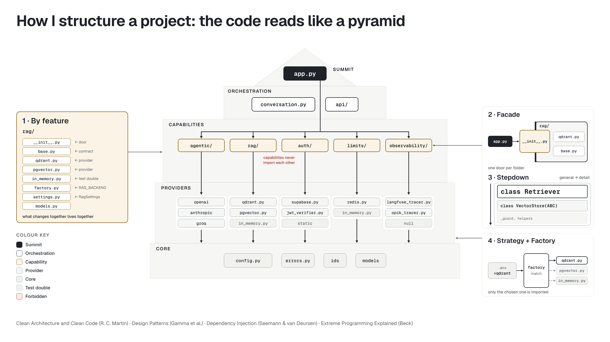

# CopyPasta-Kitchen 🍝

Recetario de plantillas para que los agentes de código (Claude Code y similares) **no se inventen la estructura** de un proyecto, sino que partan de patrones ya probados.

Cuando un agente tenga que crear una API con FastAPI, un agente con LangGraph, un frontend, etc., consulta este recetario, carga **solo la receta que necesita** y la usa como referencia.

## Objetivo

- Reunir en un único sitio los patrones de proyectos reales ya desarrollados (aurora, rag_tool_upv, ATI_PLATFORM, Vera-Symplia…).
- Convertirlos en **recetas** reutilizables: backend, agentes, frontend, infraestructura, tests…
- Que un agente pueda **descubrir, leer y descargar** una receta sin tener que cargar el repositorio entero en su contexto.

## Filosofía de las recetas

Las recetas siguen la forma de trabajar del autor, sobre todo en backend:

- **Factories.** Un único punto construye cada pieza intercambiable: el LLM, la memoria, la autenticación, el STT o el TTS. Un proveedor desconocido lanza un error explícito, nunca un valor por defecto silencioso.
- **Clases base y herencia.** Cada familia tiene una clase base abstracta (`BaseAgent`, `AppTool`, `Memory`…) y las implementaciones concretas solo declaran lo que las distingue.
- **Cambiar de proveedor sin tocar código.** El proveedor o el backend se eligen en los **settings** (`.env`): `ASSISTANT_MODEL=claude-sonnet-5-5` o `MEMORY_BACKEND=sql`. La factory lee el valor y construye la implementación. Cambiar de OpenAI a Anthropic, o de memoria en RAM a Postgres, es cambiar una variable.
- **Settings por bloques.** Hay un único `Settings` por proyecto y cada receta aporta su bloque, que ese `Settings` hereda.
- **Pydantic siempre.** Cualquier dato estructurado es un modelo Pydantic (`BaseModel`, `frozen=True` si es inmutable): se valida, se serializa y documenta sus campos. No hay `dataclass` en las recetas.
- **Costuras de test.** Todo se puede probar sin claves ni red: LLMs falsos, implementaciones en memoria e inyección por constructor.

## Cómo se estructura un proyecto



La visión: **el código se lee como una pirámide**. Abres una carpeta, sabes qué fichero mirar primero y desde ahí bajas de lo general al detalle sin buscar en diez sitios a la vez. No es una arquitectura hexagonal por capas (`domain/`, `application/`, `infrastructure/`), que reparte una misma funcionalidad por tres carpetas transversales. Es lo contrario: **lo que cambia junto vive junto**.

Un backend típico:

```
backend/src/{{app_name}}/
├── app.py            # la cima: lee Settings, llama a cada factory una vez y monta la app
├── api/              # rutas FastAPI: solo hablan con los servicios ya construidos
├── core/             # lo que usa todo el mundo: settings, errores, ids, modelos base
├── agentic/          # el agente: grafo, nodos, tools, prompts, memoria
├── rag/              # búsqueda en documentos: contrato, proveedores (Qdrant, pgvector, RAM), chunking
├── auth/             # quién llama: contrato y proveedores (Supabase, JWT, doble de test)
├── limits/           # cuota y rate limit: lógica en la base, almacenamiento intercambiable
└── observability/    # trazas y coste: contrato y proveedores (Langfuse, Opik, LangSmith, nulo)
```

Cuatro reglas lo sostienen:

1. **Por funcionalidad.** Una carpeta por cosa que hace el sistema, con su contrato, sus proveedores, sus modelos y su doble de test dentro. `core/` es la única carpeta transversal y debe quedarse pequeña: settings, errores, ids y modelos que de verdad usan todos. Si algo de `core/` solo lo usa una carpeta, pertenece a esa carpeta.
2. **Fachada.** Cada carpeta tiene una puerta: un fichero con su mismo nombre (`store/store.py`, `rag/rag.py`) o, en Python, el `__init__.py` que re-exporta lo público. El resto son piezas internas que nadie importa desde fuera. Excepciones: `core/`, que se importa por ficheros, y las subcarpetas de detalle (`providers/`, `queries/`).
3. **Regla de descenso.** Un fichero se lee de arriba abajo: la clase principal primero, los detalles después. Entre carpetas, igual: `app.py`, luego quien orquesta, luego cada capacidad, luego los proveedores. Las dependencias apuntan **siempre hacia abajo**: `app.py` → orquestación → capacidades → `core/`. Dos capacidades no se importan entre sí; si lo necesitan, quien las combina está un nivel por encima.
4. **Strategy + Factory, solo cuando hay algo que elegir.** Cada capacidad **intercambiable** tiene una clase base `ABC` en `base.py`, un fichero por proveedor y un `factory.py` con un `match` sobre un Enum que viene del `.env`. El proveedor se importa solo cuando se elige (instalas solo lo que usas) y un valor desconocido falla con un error que lo nombra. La lógica común vive en la clase base; la subclase solo guarda y lee. **Si solo hay un proveedor y no va a haber un doble de test, no hay clase base ni factory**: una clase concreta y punto. La abstracción se paga cuando aparece la segunda implementación, no antes.

### De dónde viene

Nada de esto es nuevo; es una combinación concreta de ideas con nombre y con libro:

| Regla de aquí | Idea | Dónde está escrita |
|---|---|---|
| Por funcionalidad | *Package by feature*, *vertical slices*, *screaming architecture*: la estructura grita qué hace el sistema, no con qué framework está hecho | Robert C. Martin, **Clean Architecture** (Prentice Hall, 2017), cap. 34 "The Missing Chapter" (con Simon Brown) y cap. 21 "Screaming Architecture". Simon Brown, charla y artículos *Modular Monoliths* (2018). Jimmy Bogard, *Vertical Slice Architecture* (2018). En Python, las *apps* de Django; en Go, los paquetes |
| Clase base + proveedores | Puertos y adaptadores (hexagonal), pero con el puerto dentro de su capacidad y no en una capa `domain/` común | Alistair Cockburn, *Hexagonal Architecture* (artículo, 2005). Martin, **Clean Architecture**, cap. 11 "DIP: The Dependency Inversion Principle" |
| Strategy + Factory | Patrones *Strategy* y *Factory Method*; el `match` sobre un Enum es la factory moderna en Python 3.10+ | Gamma, Helm, Johnson y Vlissides, **Design Patterns** (Addison-Wesley, 1994), "Strategy" y "Factory Method" |
| Solo con un segundo proveedor | YAGNI: no se abstrae hasta que hay dos implementaciones (o un doble de test) | Kent Beck, **Extreme Programming Explained** (Addison-Wesley, 1999). Martin Fowler, artículo *Yagni* (2015) |
| `app.py` en la cima | *Composition root*: un solo sitio construye el grafo de objetos y lo inyecta; nadie más llama a una factory | Mark Seemann y Steven van Deursen, **Dependency Injection: Principles, Practices, and Patterns** (Manning, 2019), cap. 4 |
| Regla de descenso | *Stepdown rule*: el código se lee como un periódico, titular arriba y detalle abajo; aquí también entre carpetas | Robert C. Martin, **Clean Code** (Prentice Hall, 2008), cap. 3 "Functions", apartado "Reading Code from Top to Bottom" |
| Dependencias hacia abajo | *Acyclic Dependencies Principle* y *Stable Dependencies Principle*: sin ciclos entre paquetes, y se depende hacia lo estable | Martin, **Clean Architecture**, cap. 14 "Component Coupling" |
| Fachada | Patrón *Facade*: una puerta por módulo esconde las piezas internas | Gamma et al., **Design Patterns**, "Facade" |
| Lo que cambia junto vive junto | *Common Closure Principle* | Martin, **Clean Architecture**, cap. 13 "Component Cohesion" |

### Límites y cómo evitarlos

Esta forma de estructurar tiene riesgos conocidos; conviene nombrarlos para no caer en ellos:

- **Ciclos entre capacidades.** El peligro número uno de organizar por funcionalidad: `rag/` importa `auth/`, `auth/` importa `limits/`, y la pirámide se convierte en una red. La regla de dependencias hacia abajo es lo que lo evita, y se puede hacer cumplir con una herramienta (`import-linter` con contratos de capas) en lugar de confiar en la disciplina.
- **`core/` como cajón desastre.** Todo lo que no se sabe dónde poner acaba en `core/` y se vuelve la carpeta más grande del proyecto. Regla práctica: si lo usa una sola capacidad, va a esa capacidad; si lo usan dos, se pregunta primero si una debería estar encima de la otra.
- **Abstraer antes de tiempo.** Una `ABC` y una factory para algo que solo tendrá un proveedor es ceremonia (regla 4). La única excepción que la justifica es el doble de test (RAM, nulo, falso): si no vas a querer un doble, una clase concreta. Cuando llegue el segundo proveedor se extrae la base; es un cambio local y barato.
- **Imports perezosos que fallan tarde.** Importar el proveedor dentro del `match` significa que un paquete que falta no se nota hasta que ese proveedor se elige en producción. Un test que construya cada proveedor desde settings lo descubre antes.
- **Capacidades que crecen.** Una carpeta con quince ficheros ya no se lee como una pirámide. Es la señal para subcarpetas de detalle (`providers/`, `queries/`) o para partirla en dos capacidades.
- **Quién orquesta.** Cuando varias capacidades se combinan, hace falta una carpeta por encima que lo haga (`orchestrator/`, `conversation.py`). Si esa lógica se reparte entre las capacidades, se pierde el descenso.
- **Onboarding.** Quien viene de Django, de Clean Architecture por capas o de la hexagonal clásica busca `models/`, `services/` y `repositories/`. Un párrafo como este en el README del proyecto ahorra esa semana.

Las recetas de este repositorio siguen estas reglas: cada una es una capacidad con `base.py`, un fichero por proveedor, `factory.py`, `settings.py` y su doble de test, y `create_app`/`main.py` es la cima que llama a cada factory una vez.

Los diagramas de cada regla (la montaña, por funcionalidad frente a por capas, Strategy + Factory y cuándo no, fachada y descenso) están descritos en [docs/diagrams.md](docs/diagrams.md), en inglés (el texto de las imágenes también), con sus nombres de archivo en `docs/img/`.

## Recetas

### Disponibles

| id | Categoría | Para qué | Relación |
|---|---|---|---|
| `project-settings` | backend | `Settings` único del backend (pydantic-settings, `.env`), `get_settings()` y composición por bloques | — |
| `langchain-agent` | agents | Agente con `create_agent`: clase base, factory de LLM (OpenAI, Anthropic, Azure y Groq), tools, prompts YAML | usa `project-settings` |
| `agent-memory` | agents | Memoria de conversación: backend en settings (RAM o SQL), ventana por turnos, idempotente, tests de conformidad | usa `project-settings` |
| `langgraph-graph` | agents | Grafo de flujo fijo (router → agente \| rechazo) con salida en JSON o SSE | requiere `langchain-agent` y `agent-memory` |
| `fastapi-base` | backend | Base de una API FastAPI: `build_app` con request id en respuestas y logs, 500 sin internals, errores con `code`, CORS por settings, `/health`, docs solo en desarrollo | usa `project-settings` |
| `auth-verifier` | backend | Quién llama a partir del token Bearer: Supabase (JWKS), JWT propio o doble de test, elegido en settings, con 401/503 y mapeo de claims en un método | usa `project-settings` |
| `agent-chat-api` | backend | Endpoints FastAPI del chat: `POST /agent/chat` (JSON) y `/agent/stream` (SSE), auth Bearer, guards (404/401/403/429) y `create_app` | requiere `fastapi-base`, `langgraph-graph`; usa `project-settings`, `auth-verifier` |
| `conversation-history` | backend | Historial del chat: `GET /conversations` (lista paginada con título), `GET /conversations/{id}/messages` y `DELETE`, sobre la memoria de `agent-memory` | requiere `agent-chat-api` |
| `agent-feedback` | backend | Pulgares sobre las respuestas del agente: un voto por usuario y mensaje (upsert), comentario, deshacer y lista por conversación; backend RAM o SQL | requiere `agent-chat-api`, usa `project-settings` |
| `rate-limit-quota` | backend | Rate limit por usuario y cuota diaria/mensual por tenant: lógica en clases base, backend RAM o SQL por settings, 429 con `code` y `GET /agent/quota` | usa `project-settings`, `agent-chat-api` |
| `rag-retriever` | backend | Búsqueda en los documentos del tenant: chunking, embeddings (OpenAI o local), store RAM/Qdrant/pgvector por settings, indexado idempotente por hash y el `document_search` de la tool del agente | usa `project-settings`, `langchain-agent` |
| `observability` | backend | Trazas por turno en Langfuse, Opik o LangSmith (settings), tokens, coste y duración en el log; apagado por defecto y fail-open | usa `project-settings`, `agent-chat-api` |
| `voice-providers` | backend | Dictado y lectura en voz alta: `POST /voice/transcribe` (multipart) y `/voice/synthesize`, proveedor OpenAI o doble local por settings, audio nunca guardado, errores por causa (413/415/422/429/502/503/504) | requiere `fastapi-base`, `auth-verifier`; usa `project-settings` |
| `vite-react-base` | frontend | SPA Vite + React + TS para un backend Python: API intercambiable (http o fake) por configuración, cliente con auth y errores tipados | — |
| `react-agent-chat` | frontend | Chat con un agente en streaming SSE: tokens, tools, cancelar, errores, Markdown seguro | requiere `vite-react-base`, usa `agent-chat-api` |

`requires`: hay que copiar las dos recetas. `uses`: se integra con la otra receta, pero no la trae.

### Pendientes

Ver la hoja de ruta. Quedan las extensiones del frontend (auth con Supabase, router, e2e) y la CLI `copypasta`.

## Conceptos

| Concepto | Qué es |
|---|---|
| **Receta** | Una pieza reutilizable (p. ej. `fastapi-base`). Vive en `recipes/<categoría>/<id>/`. |
| `RECIPE.md` | Explica cuándo usar la receta, las decisiones que toma y cómo adaptarla. |
| `files/` | Los archivos de la plantilla, listos para copiar. |
| `catalog.yaml` | Índice de todas las recetas: id, categoría, descripción de una línea y tags. |
| `analysis/` | Notas de los patrones encontrados en cada proyecto de origen, antes de convertirse en recetas. |

## Estructura

```
CopyPasta-Kitchen/
├── README.md
├── AGENTS.md          # instrucciones para agentes que trabajan EN este repo
├── CLAUDE.md          # importa AGENTS.md para Claude Code
├── catalog.yaml       # índice de recetas
├── recipes/
│   ├── backend/
│   ├── agents/
│   └── frontend/
├── cli/               # CLI "copypasta" (pendiente)
└── analysis/          # análisis de los proyectos de origen
```

## Uso previsto (CLI, pendiente de implementar)

El flujo está pensado para gastar el mínimo contexto en cada paso:

```bash
# 1. Descubrir: solo ids y descripción corta
copypasta list --tag api

# 2. Leer: solo el RECIPE.md de una receta
copypasta show fastapi-base

# 3. Descargar: copia los archivos al proyecto
copypasta get fastapi-base --to ./backend
```

Sin instalación, vía `uvx`:

```bash
uvx --from git+https://github.com/damiangilgonzalez1995/CopyPasta-Kitchen copypasta list
```

### En otros proyectos

Añade esto al `AGENTS.md` (o `CLAUDE.md`) del proyecto donde trabaje el agente:

```markdown
## Plantillas
Antes de crear la estructura de una pieza nueva (API, agente, frontend…), ejecuta
`copypasta list` para ver si existe una receta. Si existe, léela con `copypasta show <id>`
y síguela en lugar de inventar una estructura.
```

## Hoja de ruta

1. [x] Definir objetivo y estructura (este README y `AGENTS.md`).
2. [ ] Analizar los proyectos de origen → `analysis/<proyecto>.md` (hecho: síntesis en `analysis/agentic-langgraph.md`, `analysis/frontend.md` y `analysis/chat.md`).
3. [ ] Convertir los patrones comunes en recetas:
   - [x] `project-settings`, `fastapi-base`, `langchain-agent`, `agent-memory`, `langgraph-graph`, `agent-chat-api`, `rate-limit-quota`, `conversation-history`, `agent-feedback`, `auth-verifier`, `rag-retriever`, `observability`, `voice-providers`
   - [x] `vite-react-base`, `react-agent-chat`
   - [ ] Frontend: auth con Supabase (`TokenProvider`), router, e2e con Playwright contra el fake
4. [ ] Implementar la CLI `copypasta`.
5. [ ] (Opcional) Skill de Claude Code que envuelva la CLI.
